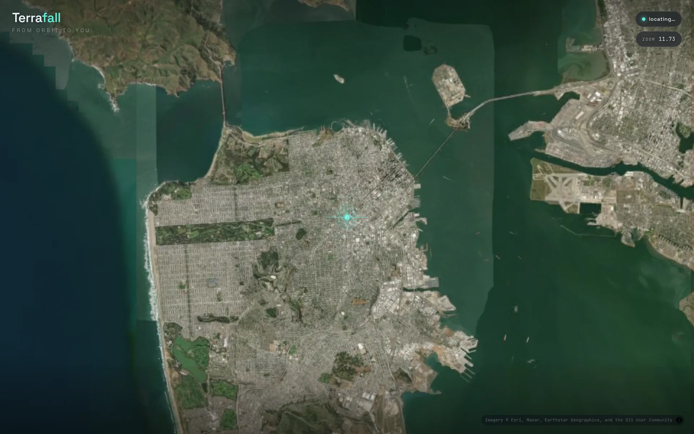
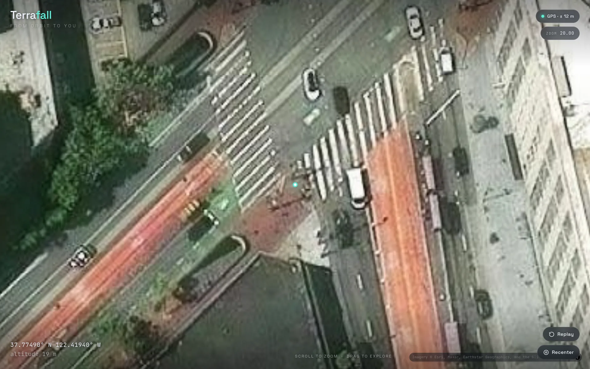

# Terrafall

A cinematic descent from orbit to the exact place you're standing right now.

**Live:** https://terrafall.iqapps.space



Open the page and a wireframe globe turns in a field of stars while Terrafall
works out where you are. The moment it has a fix, the camera leaves orbit and
falls — an eased, curved flight that ends at the deepest satellite imagery
available above your spot.



## Run it locally

It is a static site with no build step and no API keys. Everything that is
served lives in `site/`.

```sh
python3 -m http.server 4817 -d site
# open http://localhost:4817
```

Browsers only expose precise device location on `https://` or `localhost`.

## How location works

1. **Device geolocation** (GPS/Wi-Fi, `enableHighAccuracy`) gives the most
   accurate fix, down to a few metres.
2. **IP geolocation** (ipwho.is, then ipapi.co) is the fallback when GPS is
   denied, unavailable, or the site is served over plain HTTP — a city-level fix.

The camera then animates from a whole-Earth view to that spot, over-zooming to
the closest satellite tile that exists.

## Features

- A star-field loader with a rotating orbit ring and status readout
- A live zoom / altitude counter that plunges from ~12,000 km to tens of metres
- A glassmorphic HUD: detection method + accuracy, coordinates, and zoom
- A pulsing "you are here" marker, plus Replay (`R`), Recenter and Reset-north (`N`)
- Film grain and vignette for a cinematic finish, responsive down to phone width

## Deployment

Every push to `main` runs
[`.github/workflows/build_and_deploy.yml`](.github/workflows/build_and_deploy.yml):

1. **Validate:** checks that the site files exist and that `app.js` parses.
2. **Deploy:** connects to the VPS over SSH and, as the `terrafall` user, resets
   `/srv/apps/terrafall` to `origin/main`.

Nginx serves `/srv/apps/terrafall/site` over HTTPS with a Let's Encrypt
certificate. The config is tracked in
[`ops/nginx/terrafall.conf`](ops/nginx/terrafall.conf).

The workflow needs the repository secrets `SSH_HOST`, `SSH_USER`, `SSH_PORT` and
`SSH_KEY`.

## Services used (all keyless, called from the browser)

Esri World Imagery tiles · MapLibre GL JS · ipwho.is / ipapi.co IP geolocation.

## License

[MIT](LICENSE)
